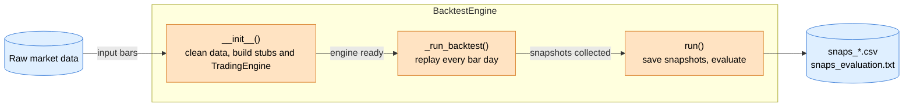
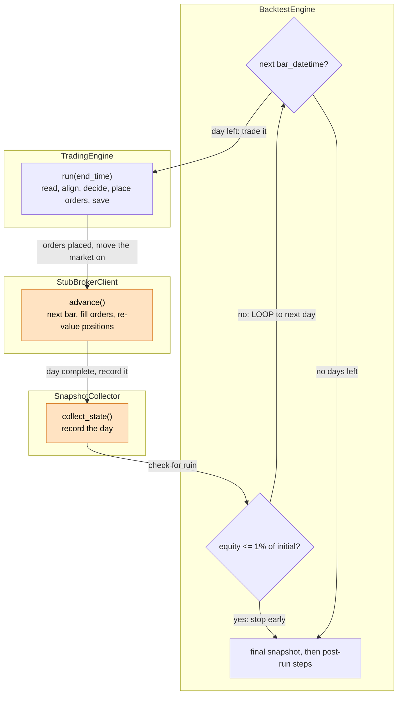
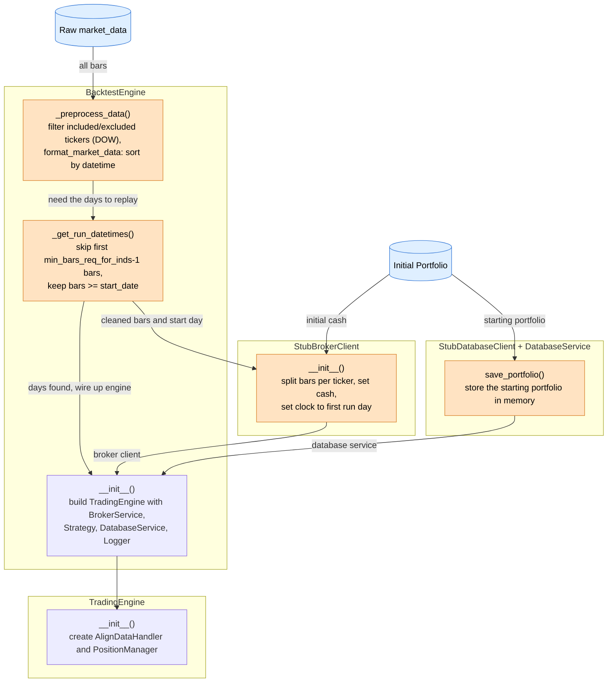
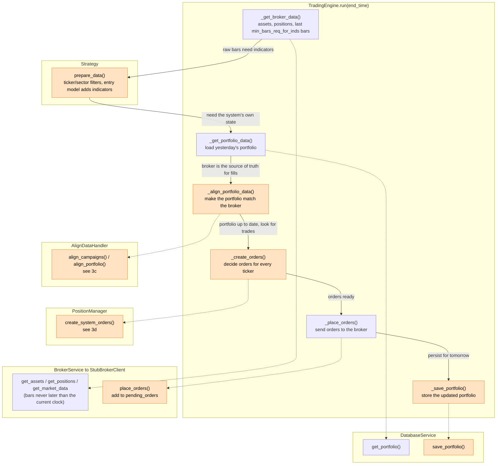
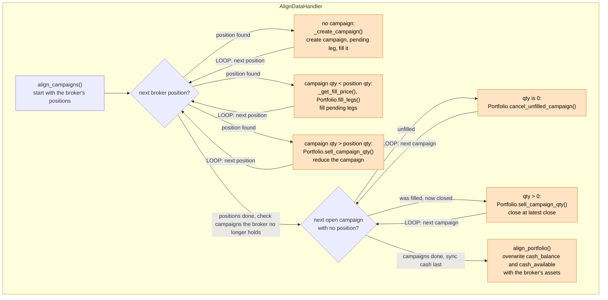
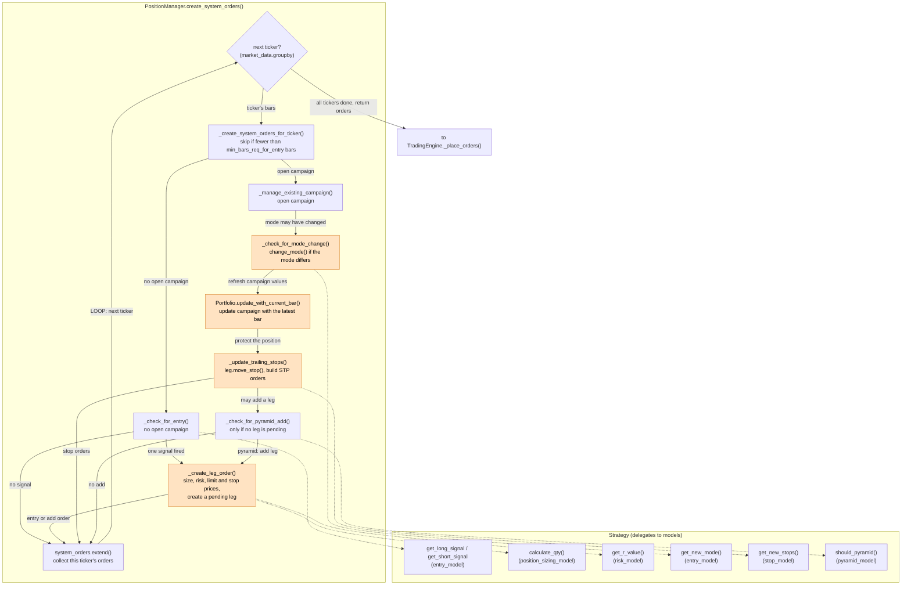
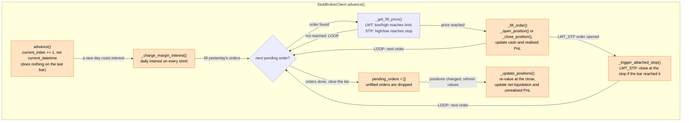
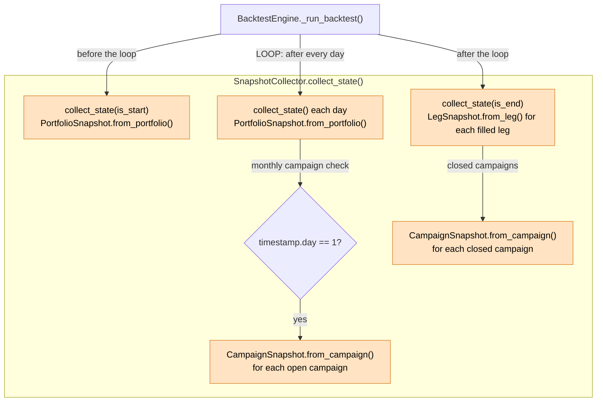
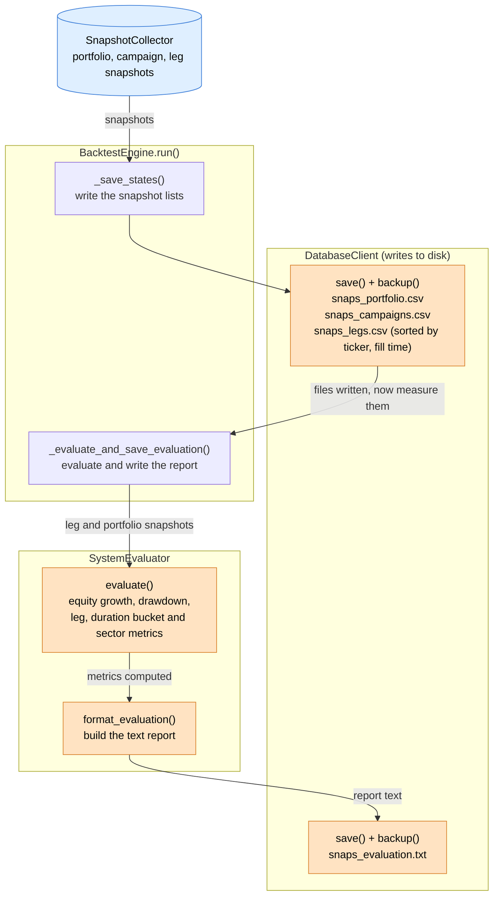

# Backtest Engine Flow

Orange boxes modify data or state. Blue cylinders are data.

## Level 1: Backtest Overview

The whole backtest in four steps. Everything after setup replays the live trading application on historical data.

## Level 2: Daily Loop Overview

What happens on each bar day, and which system does it. The loop repeats until the data runs out or equity falls to 1% of the starting equity.

## Level 3a: Initialisation

`BacktestEngine.__init__()` runs once. It prepares the data and wires the stubs into a `TradingEngine`, so `run()` only replays.

## Level 3b: TradingEngine.run()

One trading day. This is the same code the live application runs, just against the stub broker and stub database.

## Level 3c: AlignDataHandler

Syncs the system's portfolio and campaigns with what the broker actually holds, because the broker filled or closed orders since yesterday.

Branches that need no change (quantities already match) skip straight to the next position. `AlignDataHandler` also calls `Strategy.get_r_value()` when it creates a campaign.

## Level 3d: PositionManager

Decides the orders for the day. The outer loop runs once per ticker. Each ticker either looks for an entry or manages its open campaign.

## Level 3e: StubBrokerClient.advance()

Moves the fake market one bar forward. Orders placed on the previous day are filled here, using the new bar's high and low.

## Level 3f: SnapshotCollector

`collect_state()` is called three ways: once at the start, once per day, and once at the end. Only the final call produces leg and closed campaign snapshots.

## Level 3g: Post-run (save and evaluate)

After the loop, `BacktestEngine.run()` writes the snapshots to disk, then evaluates them and writes the report.

